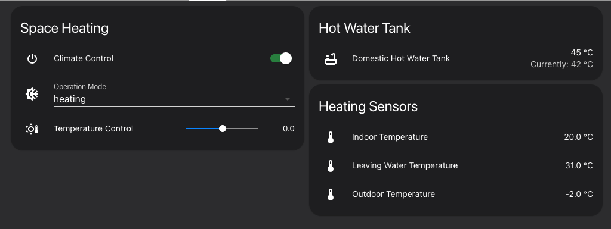
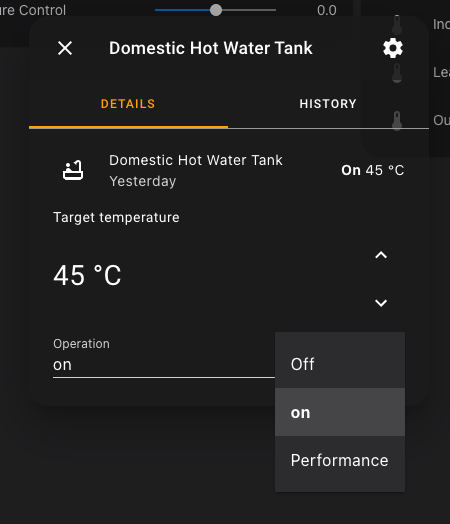
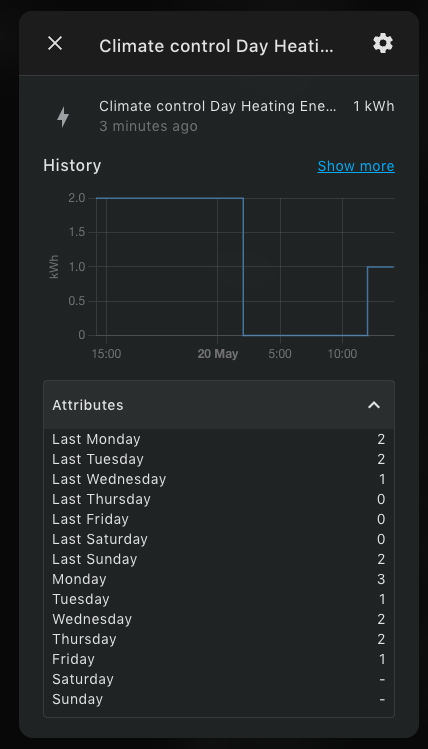

# Daikin altherma custom component for Home assistant

This HA integration is for BRP069A62 (should work with BRP069A61) Daikin Altherma LAN adapter.
Also, it has been successfully tested with D2CND with gateway DRGATEWAYAA.


The integration connects to device locally, thus internet connection is not required.

**NOTE**: This is a very early release, and comes without any guarantees. So, use it at your own risk.

# Installation

You can install manually or by using [HACS](https://hacs.xyz/) (the easier way). 
## HACS

1. Go to `HACS > Integrations`
2. Press `+ explore and & download repositories`
3. Search for `Daikin Altherma`


## Manual installation

1. Using the tool of choice open the directory (folder) for your HA configuration (where you find `configuration.yaml`).
2. If you do not have a `custom_components` directory (folder) there, you need to create it.
3. In the `custom_components` directory (folder) create a new folder called `daikin_altherma`.
4. Download _all_ the files from the `custom_components/daikin_altherma/` directory (folder) in this repository.
5. Place the files you downloaded in the new directory (folder) you created.
6. Restart Home Assistant
7. It should automatically discover your adapter !

If the adapter is not discovered automatically, go to **Settings > Devices & services >
Add integration** and search for **Daikin Altherma HVAC**.

## Setup and connection troubleshooting

Enter your **Daikin adapter's local IP address or hostname**, such as `192.168.1.50`
or `daikin.local`. Find it in your router's connected-device/DHCP list. This is not
the Home Assistant address, an Onecta login, or the heat pump's serial number.
Enter only the address, without `http://`, `ws://`, or `/mca`. IPv4, IPv6 and
hostnames are accepted; an explicit port is optional. A DHCP reservation can keep
the address stable. If it changes, adding the adapter again updates the existing
entry after recognizing its serial number, rather than creating duplicate entities.

The integration uses the adapter's local WebSocket API at `ws://<address>/mca`
(TCP port 80 by default). The adapter must be reachable **from Home Assistant**,
including across any VLAN, firewall or guest-network isolation. Automatic discovery
may not cross subnets; try manual setup if routing allows access. A successful ping,
an adapter web page, or a working Onecta app does not establish local API support.
Cloud-only adapters cannot use this integration. Compatibility depends on the
exposed API and capabilities, not just the heat-pump model or whether your network
uses Wi-Fi. There is no verified firmware compatibility matrix for all adapters.

- **Invalid address:** enter an IP address or hostname, without a URL scheme or path.
- **Could not connect:** check the address, adapter power, name resolution and network
  access from Home Assistant.
- **Setup timed out:** the connection or discovery did not complete within the timeout.
  Check connectivity and retry; this does not by itself prove incompatibility.
- **Unexpected API response:** the WebSocket handshake, protocol response or device
  information could not be read as expected. Check the address and collect logs;
  the cause may be an unsupported API, a firmware/profile difference or a transient failure.

Setup failures are logged under `custom_components.daikin_altherma` in **Settings >
System > Logs**, including the address and exception type. For more detail, enable
debug logging on the integration if available, or merge the following into your
existing `configuration.yaml` logger configuration and restart Home Assistant:

```yaml
logger:
  default: warning
  logs:
    custom_components.daikin_altherma: debug
    pyaltherma: debug
```

Reproduce the failure, then disable debug logging. When reporting a problem, include
the adapter model, firmware, Home Assistant and integration versions, the setup
error, and relevant log lines. Review debug logs before sharing: protocol responses
can contain serial numbers and other device or network details. A browser opening
the adapter's home page is not a test of the `/mca` WebSocket API.


# Features

This integration allows to control the following options

**For water heating:**
 - Get/Set target temperature
 - Get water temperature
 - Separate current and target temperature sensors for graphs and automations
 - Turn off/on
 - Turn powerful

**For space heating:**
 - works with both states weather dependent and fixed
 - Operation State (heating/cooling/auto)
 - Leaving water temperature heating/cooling/auto (get/set)
 - Leaving water temperature offset heating/cooling/auto (get/set)
 - Indoor temperature
 - Outdoor temperature
 - Current leaving water temperature
 - Turn on/off
 - Operation mode

## Screenshots







# Climate control component

I do not own room thermostat, therefore I cannot properly test it. In this case I just control leaving water temperature.
Daikin device allows to control leaving water temperature which is not what you expect your room temperature to be it is either higher or lower (if cooling is turned on). 
If you don't have thermostat you can use [generic thermostat](https://www.home-assistant.io/integrations/generic_thermostat/) which comes with HA by default.

Put this into your `configuration.yaml`:

```yaml
climate:
  - platform: generic_thermostat
    name: My Heater
    unique_id: daikin_climate_control
    target_sensor: sensor.indoor_temperature
    min_temp: 18
    max_temp: 26
    heater: switch.climate_control
    target_temp: 20
    cold_tolerance: 0.3
    hot_tolerance: 0.3
    ac_mode: false
    initial_hvac_mode: "heat"
    min_cycle_duration:
      seconds: 5
``` 

`target_sensor` can be any temperature sensor. 


<a href="https://www.buymeacoffee.com/buymeacoff7" target="_blank"></a>


## Compatibility and development

Controls are created from the capabilities advertised by the adapter, without model-specific
branches. The integration supports installations with space heating, domestic hot water, or
both, and keeps each configured adapter's polling and connection separate. Existing entity
unique IDs are preserved.

Polling runs every five seconds. Failed reads mark entities unavailable; successful reads
restore them. Temporary connection failures during setup are retried by Home Assistant.
Commands and polling share a lock and bounded timeouts. Unsupported temperature controls
and temperatures outside the device's advertised limits raise an error instead of silently
succeeding.

The regression suite runs against Home Assistant 2024.6.4, 2025.4.4, and the latest release
compatible with Python 3.14. These checks use real Home Assistant entity and coordinator
classes with simulated adapter responses; they are not a claim that every heat-pump model
has been hardware-tested. Older Home Assistant versions are not covered by this matrix.

To run locally using Python 3.13:

```sh
python -m venv .venv
. .venv/bin/activate
python -m pip install -r requirements-test.txt 'homeassistant==2025.4.4'
python -m pytest -q
ruff check custom_components tests
ruff format --check custom_components tests
```

Tests cover both hot-water temperature schemas, fixed and weather-dependent controls,
missing optional units, concurrent adapters, cancellation, connection failures, and recovery.
Consumption tests cover missing/partial readings; energy accounting across billing or
calendar boundaries still needs validation against real adapter histories.

The **Water Tank Current Temperature** and **Water Tank Target Temperature** sensors
are created when the adapter advertises those readings. They share the water-heater
entity's cached data and add no polling. Current temperature supports long-term
measurement statistics; the target sensor exposes the setpoint for history and automations.
Missing or invalid readings are reported as unknown rather than zero.

Consumption entities use **Space Heating** or **Hot Water Tank** when the adapter
returns an empty name or `$NULL`. Existing entity IDs and custom names are preserved;
previously generated entity IDs containing `null` are not automatically renamed.

The unit problem sensors report error, warning, and emergency flags. Installer mode,
weather-dependent operation, and overridden targets remain visible in their attributes
but do not by themselves indicate a fault. Boolean status strings such as `"0"` and
`"false"` are decoded before the pinned library's boolean conversion.

Adapters that advertise them also expose the active space-heating setpoint, tank
operation mode, fault code, and active and next schedules. Schedule and fault
details refresh once per minute. An unsupported or missing detail appears as
unknown. On tanks advertising both heating and standby, the water heater switches
between those modes. The separate Power switch controls the unit's power when
the adapter advertises that control.
